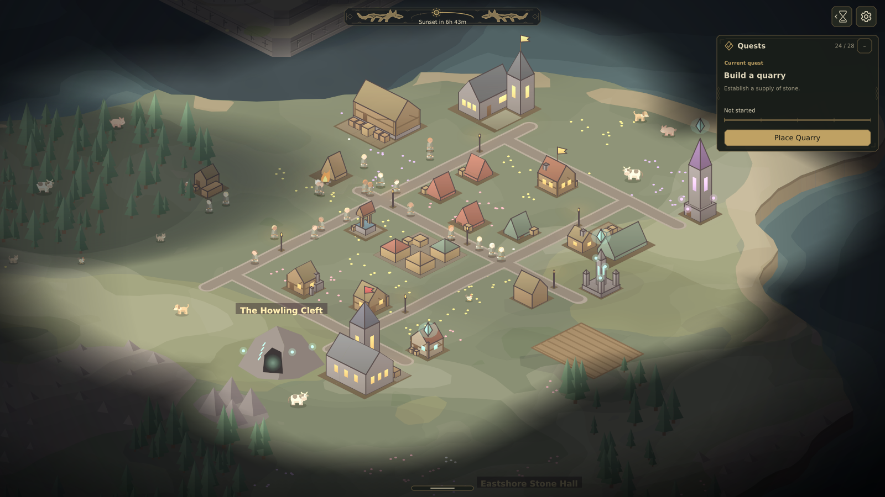
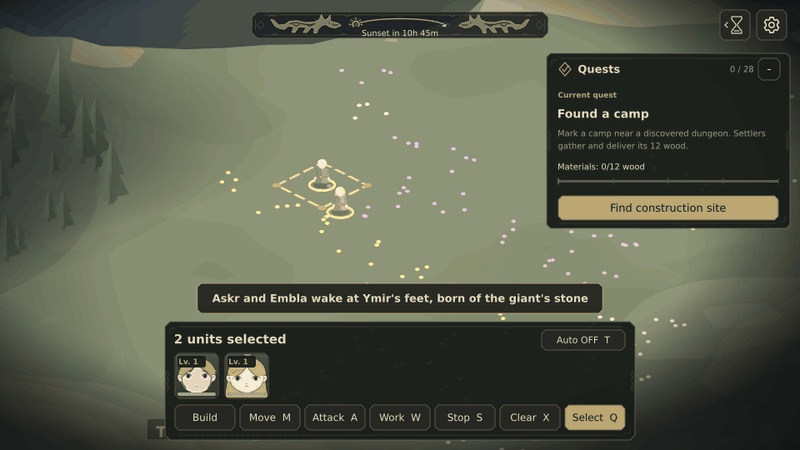
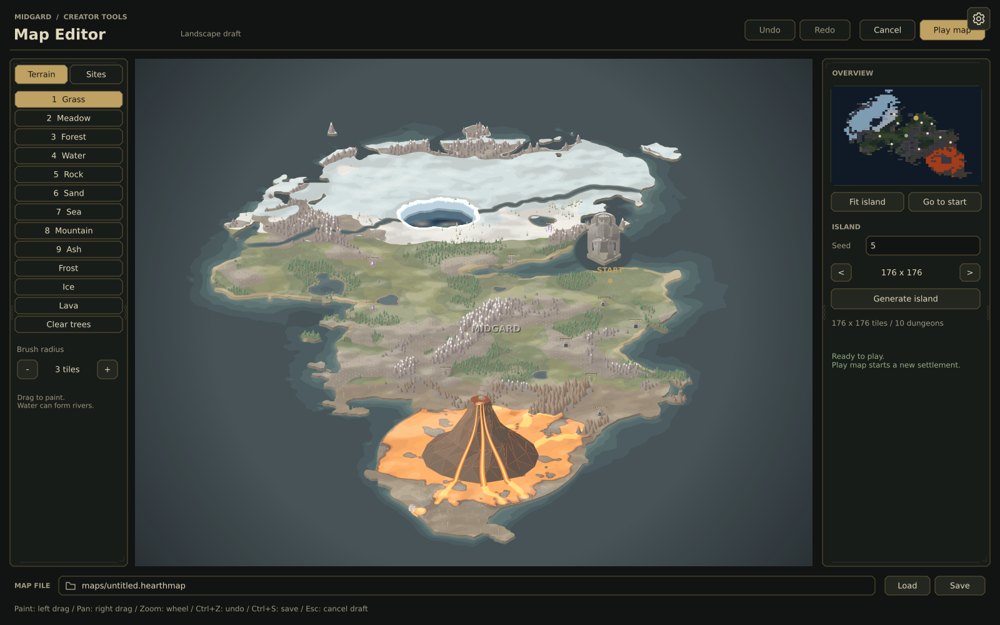
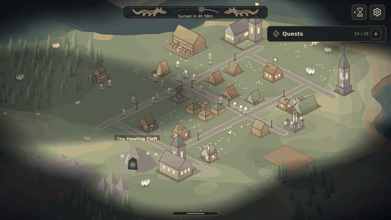
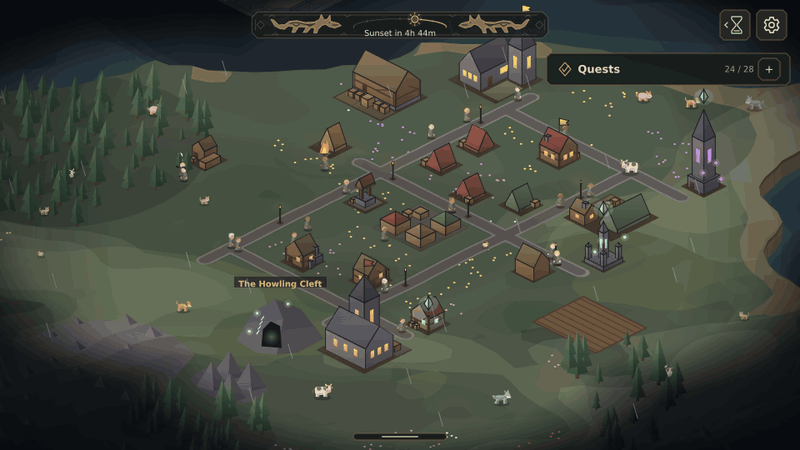
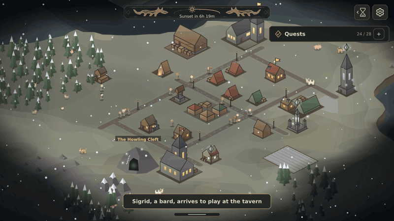
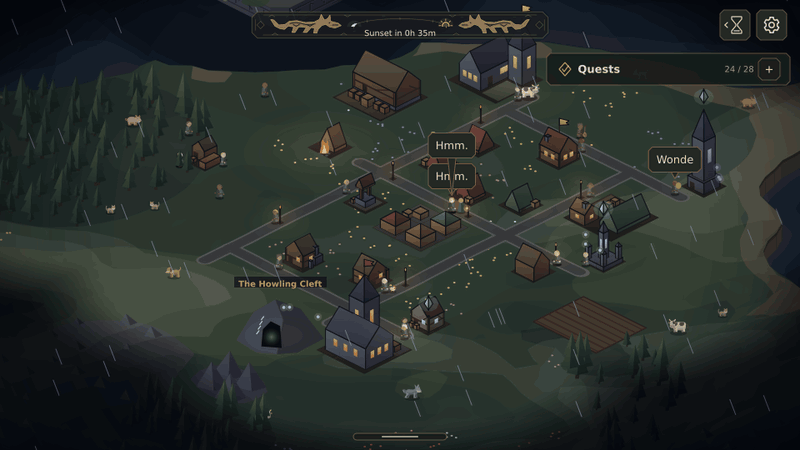
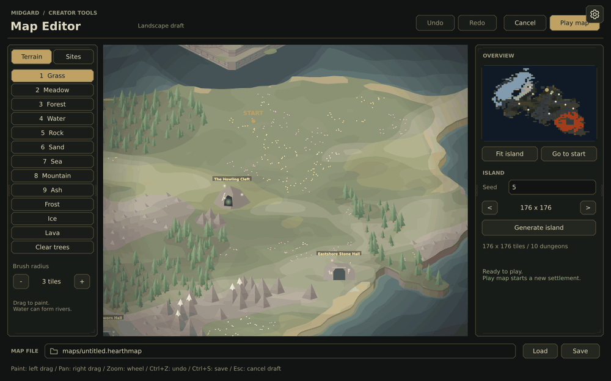

<div align="center">

# Midgard

**Two settlers. A wild world. Your first settlement.**

A Norse settlement simulation about building a home, connecting a town, and caring for the people who live there.

**Settlement building · Living villagers · Exploration · Creative tools**

[Play locally](#play-locally) · [Controls](#controls) · [Publish to GitHub Pages](#github-pages) · [ThorVG WebCanvas](https://github.com/thorvg/thorvg.web)



</div>

## From a camp to a town

Found a camp near a discovered dungeon. Mark out your first road, establish a lumberyard, and give your settlers the foundations of a new home. Farms, wells, houses, inns, markets and workshops open up as the settlement develops.

Construction happens in the world. Workers gather and carry missing supplies, while completed roads let connected camps supply nearby worksites. A blueprint becomes a worksite, then a place your people can use.



_Actual construction simulation, shown as a time-lapse._

## Connect the work. Care for the people.

Draw roads between the places that matter: homes, workshops, storage and resource patches. Extend the network as you grow, then pave busy routes when you can supply the materials.

Your residents have homes, workplaces, hunger, rest and wages. Build the facilities that keep them supplied, make room for visitors, and create space for new residents to settle. An inn, a market or a guild changes what the town can offer.

Select a resident and give a direct order to move, gather, build or fight. Turn on Auto when you want residents to choose useful work and look after their needs. Your orders still take priority.

## A world beyond your doorstep

Follow the river, explore forests and coastlines, and uncover landmarks and dungeons beyond the fog. The world has its own wildlife, weather and threats. Prepare your settlement for monsters and raids, and choose when to send a party into a dungeon.



_Full-world overview. Normal play reveals the map through exploration._

## Watch the sky change

Morning becomes evening. Torches glow after sunset. Rain, storms and snow change the atmosphere, while the calendar brings new seasons and harvests. The sun and moon track the world clock above your settlement.



_The same settlement across a day/night time-lapse._

### Rain

Rain sweeps across the roads and rooftops as village life continues.



### Snow

Winter brings drifting snowflakes and snow-covered trees and fields.



### Thunderstorms

Lightning briefly lights the settlement beneath the storm clouds.



## Shape your characters

Open **Character Studio** from the title screen and give your settlers a face of their own. Choose dot or open eyes, adjust their shape, size and spacing, then shape the eyebrows and mouth. Refine the skull, jaw and chin while watching the portrait update as you edit.

Compare your changes with the original, step back with Undo, and save a character preset when you are happy with the result.

## Draw your own world

Open **Map Editor** from the title screen and paint the landscape directly. Trace a river, grow a forest, and reshape the terrain as the map updates beneath your brush. Undo and redo strokes while refining your design, then save the map or use **Play map** to start a settlement in it.



## Make it your world

- **Building Studio:** inspect and edit building assets, then save, export or apply your changes.
- **Save and continue:** return to your settlement later. The title's autonomous village is a separate simulation and does not change your saved game.

The opening quests guide the first steps: **Camp → Road → Lumberyard → Farmhouse → Field → Well → Tent → Hostel**.

## Drawn with ThorVG WebCanvas

Midgard is a playable showcase for **[ThorVG WebCanvas](https://github.com/thorvg/thorvg.web)**. Its vector artwork, animated buildings, characters, weather and in-game canvas UI are rendered in the browser through WebCanvas.

The game logic is TypeScript. WebGL is the default renderer; software rendering and WebGPU can also be selected. The world fills the browser window and follows window-size and display-scale changes.

The media above is captured from the actual renderer. The settlement showcase is prepared for photography. The construction and day/night GIFs accelerate simulation time; the weather clips show the game’s own weather effects.

## Controls

| Action                       | Input                                     |
| ---------------------------- | ----------------------------------------- |
| Select a unit or object      | Left click                                |
| Select a group               | Left-button drag                          |
| Command selected units       | Right click a destination or target       |
| Prepare Move / Attack / Work | `M` / `A` / `W`, then choose a target     |
| Pan the camera               | Arrow keys or right-button drag           |
| Zoom                         | Mouse wheel                               |
| Pause / change speed         | `Space` / `Tab`                           |
| Save                         | `Ctrl+S` or `Cmd+S`, or the settings menu |
| Open Building Studio         | `F4`                                      |

Start, Continue, Character Studio and Map Editor are available from the title screen. Browser sound begins after an interaction.

The opening splash uses the supplied Powered by ThorVG animation while the world loads. Tap or click once to enable sound. Opening effects are loaded first; music and the voices in use take priority over the remaining audio downloads.

## Play locally

Use **Node.js 24** and npm, matching the CI environment.

```sh
npm ci
npm run dev
```

Open the address printed by Vite, normally **http://127.0.0.1:5173/**.

Saves, maps and custom assets are stored in IndexedDB and persist across reloads. Clearing site data removes them. Different browser profiles or site origins (protocol, host or port) use separate storage; paths on the same origin share it. Existing GoldFantasy saves remain compatible with Midgard.

## Production build

```sh
npm run build
npm run preview
```

The production site is written to `dist/`. It runs on static HTTP(S) hosting; no game server or account is required.

Optional launch parameters include `?seed=42`, `?renderer=sw`, `?renderer=wg`, `?character-studio` and `?map-editor`.

## GitHub Pages

The [Pages workflow](.github/workflows/pages.yml) builds and deploys `dist/` when changes reach `main`. It can also be started manually from the Actions tab.

1. In the repository, open **Settings → Pages → Build and deployment**.
2. Set **Source** to **GitHub Actions**.
3. Push the changes to `main`, or run the **Deploy Midgard to GitHub Pages** workflow.

For the current repository, the site address after a successful deployment is:

**https://ossca-thorvg.github.io/GoldFantasy/**

The game name is Midgard; the repository name determines the URL. The workflow supplies the repository base path so fonts, audio, the audio worklet and WebAssembly load correctly below `/GoldFantasy/`.

For another static host, set the base path before building, for example:

```sh
VITE_BASE_PATH=/midgard/ npm run build
```

Serve `dist/` at that path with WebAssembly served as `application/wasm`.

## Regression checks

```sh
npm test
npx playwright install chromium
npm run test:roads
npm run test:loading
npm run test:audio
```

The tracked suite in `tests/regression/` checks work priorities and draws roads through the actual game UI in all four directions around a naturally built first camp. Browser checks also cover the supplied splash, early touch sound activation and playback before background audio finishes. They run headlessly with muted output, use temporary servers and close their own resources. Both build workflows run these checks before publishing.

Real WebAssembly ownership checks also repeat UI reordering, clipping, masking and animation moves 70,000 times. Asset preparation applies a checksum-verified reference ownership fix to the pinned WebCanvas 1.1.3 package; changing that dependency requires reviewing the compatibility patch.

## Technology and credits

| Technology / asset                                       | Used for                                                                  |
| -------------------------------------------------------- | ------------------------------------------------------------------------- |
| [ThorVG WebCanvas](https://github.com/thorvg/thorvg.web) | World rendering, vector characters and buildings, effects and canvas UI   |
| TypeScript                                               | Simulation, navigation, orders, economy, scenes, editors and audio mixing |
| Vite + npm workspaces                                    | Development, production builds and the TypeScript monorepo                |
| Web Audio + AudioWorklet                                 | Ambient sound, music, effects and voices                                  |
| IndexedDB                                                | Browser-local saves and creative documents                                |
| Lua 5.4.8 in WebAssembly                                 | Optional scripted HUD extensions                                          |
| DejaVu Sans / DejaVu Sans Bold                           | In-game text                                                              |
| Loach-generated audio                                    | Procedural music, ambience, effects and generated voice banks             |

Midgard continues the GoldFantasy project and its original game artwork and rules.

## License

The project is distributed under **GNU GPL version 3**. See [LICENSE](LICENSE).

Third-party components keep their own licenses:

- **ThorVG WebCanvas:** [MIT license](public/licenses/ThorVG-WebCanvas-1.1.3.txt).
- **Lua 5.4.8:** [MIT license](public/licenses/Lua-5.4.8.txt).
- **DejaVu fonts:** [Bitstream Vera license and DejaVu public-domain changes](public/assets/native-fonts/DejaVuSans.LICENSE).
- **Audio:** [asset-specific provenance and notices](public/assets/audio/NOTICE.md).
- **Powered by ThorVG splash:** [supplied animation source and provenance](public/assets/branding/NOTICE.md).

See [all third-party notices](public/THIRD_PARTY_NOTICES.md) for additional bundled material.
