<div align="center">

# Midgard

**Two settlers. A wild world. Gates to other worlds.**

A Norse settlement game about building a home, raising a few precious people, and leading them against the swarms beyond the gates.

**Settlement building · Crafting in the world · Army combat · A living world · Creative tools**

[Play locally](#play-locally) · [Controls](#controls) · [How it is made](https://thorvg-community-kr.github.io/Midgard/docs.html) · [Publish to GitHub Pages](#github-pages) · [ThorVG WebCanvas](https://github.com/thorvg/thorvg.web)


_The frost giant Ymir awakens in the first scene of the opening saga. Shown at 1.5× speed._

</div>

## From a camp to a town

Two founders wake on the shore and wait for your word. Found a camp, put up a workbench and make the first tools, then grow the camp into a town of homes, workshops, farms, markets and halls.

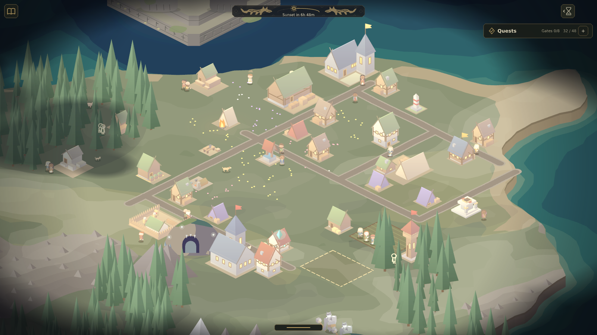

_A grown settlement, prepared for photography: the buildings are placed by the game's own placement rules and finished at once; the residents live their own day._

Construction happens in the world. Builders gather what a site lacks and carry it there in their packs, hand it to each other, or take it from storage. A blueprint becomes a worksite, then a place your people can use.

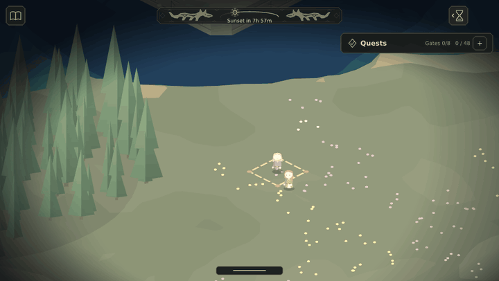

_The two founders build the first camp from nothing. Real simulation as a time-lapse, about twelve times the pace of play._

## Tools are made, not bought

Items are made in the open. Build a workbench and send a resident to it: they walk there, work at the bench, and the finished item goes straight into their pack. Nothing is paid until the item is done. A tool makes one kind of work faster, in tiers from bare hands to wood, stone and iron, and it works from the pack without taking a slot. The smithy forges weapons, shields and armour; the workbench and the smithy are each raised to higher levels for better recipes. A shield turns some blows aside when its bearer fights one-handed, and armour soaks some damage.

<table>
  <tr>
    <td width="50%">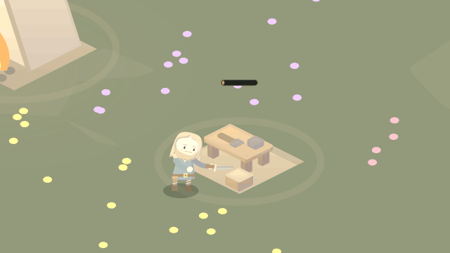</td>
    <td width="50%">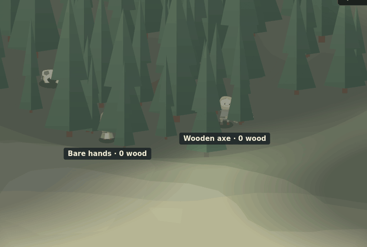</td>
  </tr>
  <tr>
    <td><em>A founder makes a wooden axe at the workbench. About three times the pace of play.</em></td>
    <td><em>The same work with the new axe and by hand: the axe brings in two loads of wood while the hands bring one. About three times the pace; the captions are added for this page.</em></td>
  </tr>
</table>

The founding quests lead the way: a camp, a workbench and wooden tools, a smithy, a first weapon and a shield, then homes, a field and Odin's altar, before the Trade, Arms, Faith and Saga branches open. The first time something important happens, a guide card explains it and keeps it in a log you can reread (`F1`). A landmark is explained only once it is actually in view.

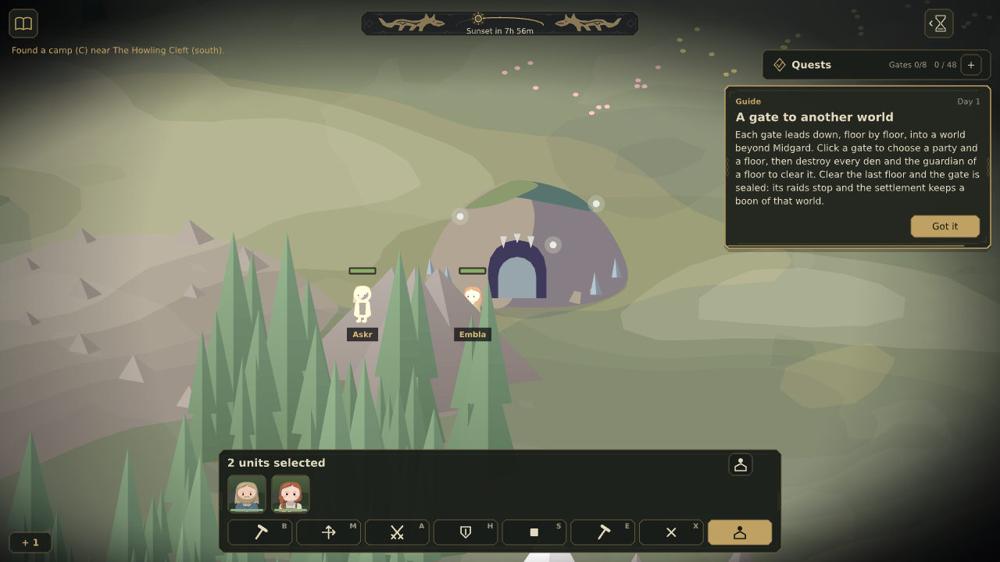

_The guide card for the first gate a founder sees._

## Build and connect the settlement

Draw roads between the places that matter: homes, workshops, storage and resource patches; pave the busy ones. A building, field or road you no longer want can be cleared by a crew. Homes grow from tents into cottages and townhouses. Residents have homes, work, hunger, rest and wages; turn on Auto and they choose useful work and look after their needs, while your orders still come first. Gathered goods ride in each worker's pack until it is full, and a heavy pack slows its carrier.

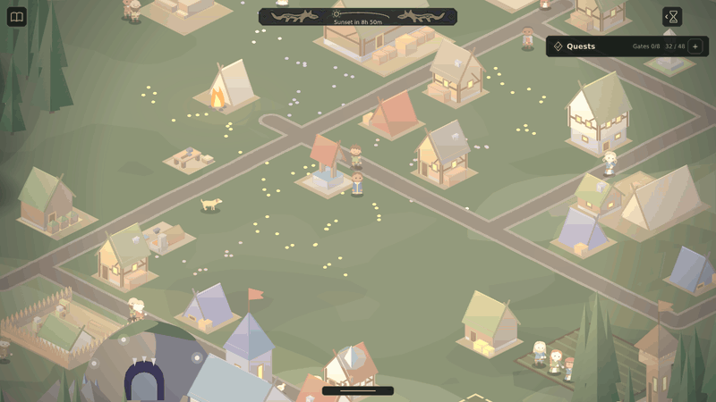

_A day in the prepared town, at about three and a half times the pace of play._

## Odin's altar

New residents are called at Odin's altar. Choose what to lay before it: water, bones, gold, food and stone. The richer the offering, the higher its grade, from humble to kingly, and the stronger the newcomer it tends to bring. A small offering can be refused, and the gifts are gone either way. Odin sends only so many people: the number rises as floors beyond the gates are cleared.

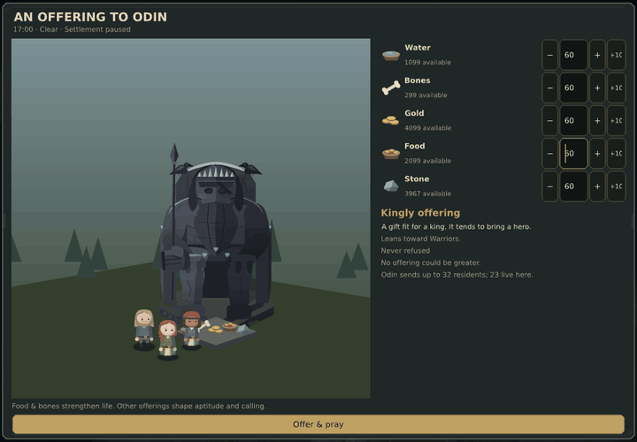

_One kingly offering in the prepared town, from the filled-in offering to the newcomer. About twice the pace of the rite._

## Few against many

Beyond each gate lies another world, three floors deep. Its monsters win by numbers: swarms pour out of dens that keep breeding until they are destroyed, and a guardian holds every floor. Your residents are few and precious. Choose a party and a floor in the gate's expedition window, then lead them through.

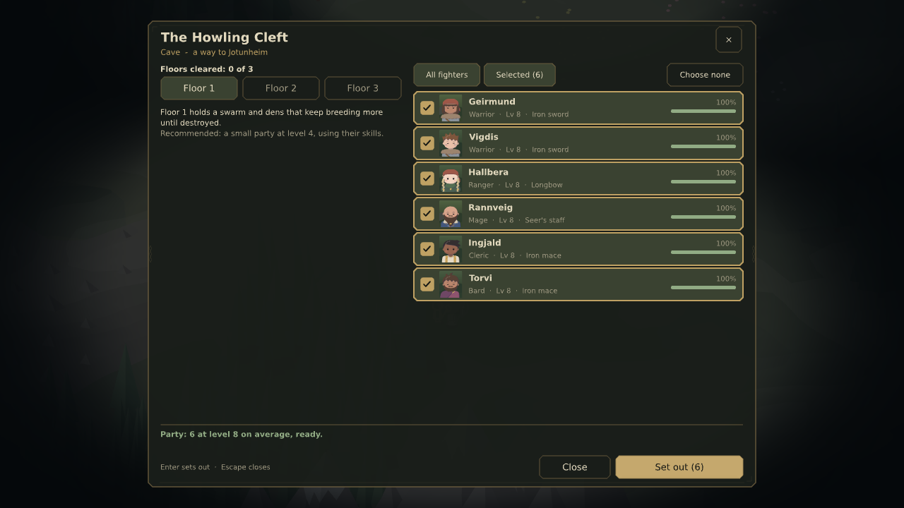

_The expedition window of a gate, with a staged party of six._

Move ignores the enemy, attack-move fights on the way, and a chosen target comes first. A group move arrives in formation, with blades in front and bows and staves behind; Hold stands its ground and never chases. Put residents in control groups and fire each calling's two skills by hand or leave them on auto: a warrior's challenge and whirl, a ranger's aimed shot and volley, a mage's rune burst and frost ring, a cleric's mending and sanctuary, a bard's verse and dirge.

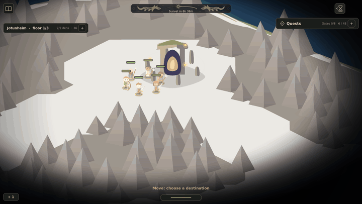

_A move order for the whole party: the marks on the ground show the formation, then the party holds. One and a half times the pace of play; the nearest packs were taken off this floor so the move stays a move._

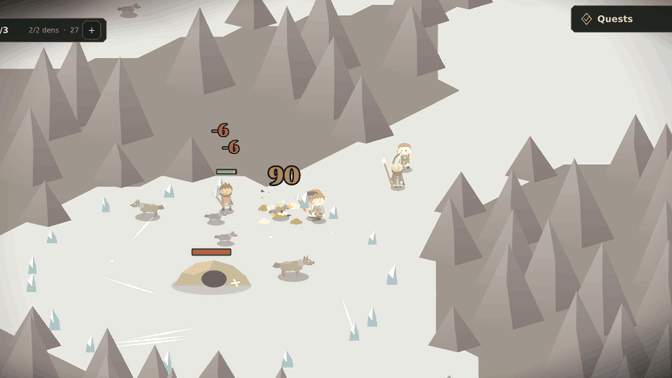

_Six residents attack-move on a den beyond a gate; their skills fire on auto until the den falls. Real time; the party is staged, the fight is the game's own._

A resident at the end of their strength is not lost at once: they fall and bleed out unless an ally reaches them and kneels beside them in time. When the party comes home, a result screen tells what was slain, how each member fared and what was won. Seal every gate to win.

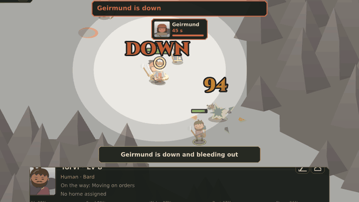

_A warrior is struck down and a bard raises them. Real time; the fall is staged._

## The wilds

Wildlife roams the land and can be hunted for food. Forests and mountains are tall and dense, so units behind them are drawn as outlines and a fight in the woods stays readable.

<table>
  <tr>
    <td width="50%">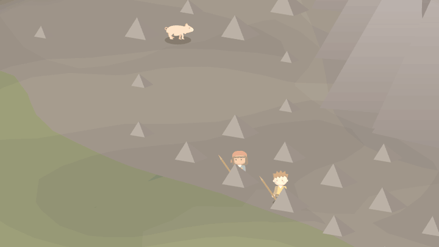</td>
    <td width="50%">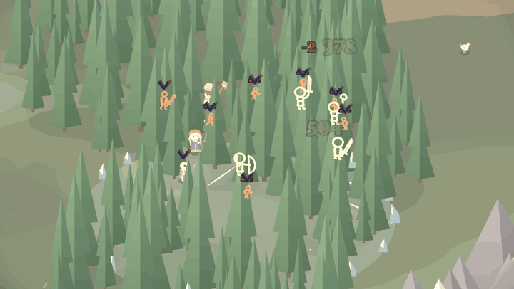</td>
  </tr>
  <tr>
    <td><em>Two staged hunters chase down a wild pig. About three times the pace of play.</em></td>
    <td><em>A staged party and swarm fighting deep in a forest; whoever is behind a tree is outlined. Real time.</em></td>
  </tr>
</table>

## A living world

Morning becomes evening, torches and windows glow after sunset, rain splashes on the ground, and the calendar brings seasons, harvests and snow. Bards play their lyres for the settlement. Winter thins the wildlife and brings more raids, which are warned on the day.

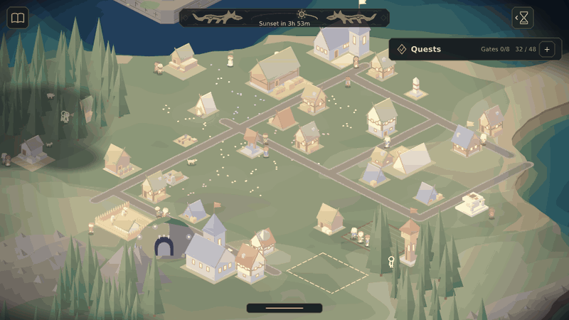

_The prepared town across a day, as a time-lapse._

<table>
  <tr>
    <td width="33%">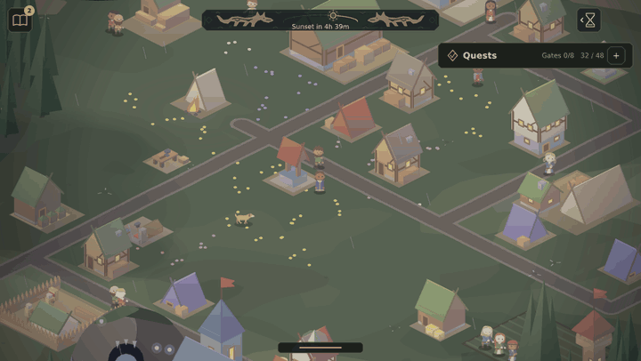</td>
    <td width="33%">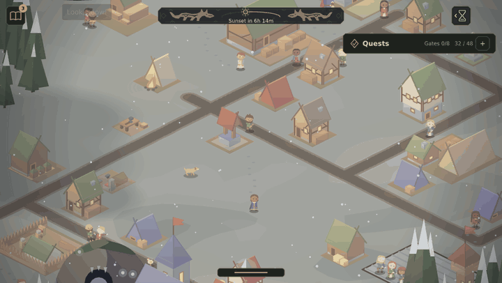</td>
    <td width="33%">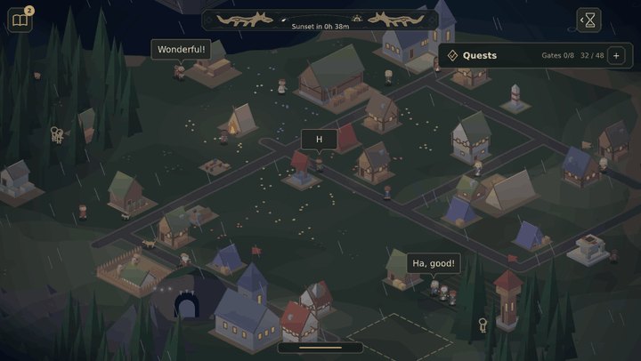</td>
  </tr>
  <tr>
    <td><em>Rain.</em></td>
    <td><em>Snow on a winter day; the ground has whitened under the sky's own snowfall.</em></td>
    <td><em>A thunderstorm and a natural bolt.</em></td>
  </tr>
</table>

_The weather clips run at the pace of play, from the game's own sky._

Once the settlement has a camp fire, an altar of Odin and enough residents, Thor comes down now and then to stay a few nights. He takes no orders. By day he enjoys the settlement; by night he hunts the monsters that come near it with his hammer.

<table>
  <tr>
    <td width="50%">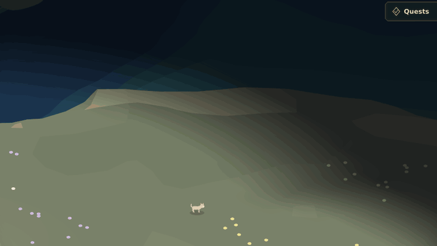</td>
    <td width="50%">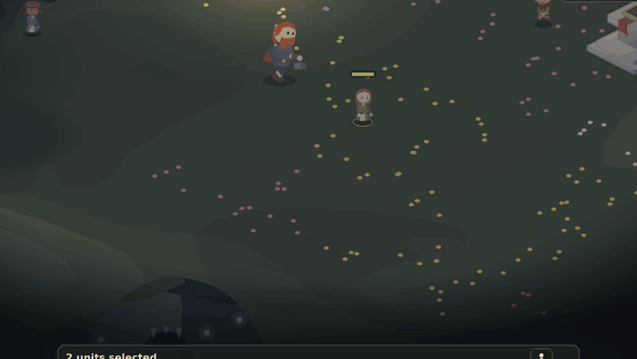</td>
  </tr>
  <tr>
    <td><em>Thor arrives in his bolt. Real time.</em></td>
    <td><em>His night hunt: the hammer falls on staged raiders. Real time.</em></td>
  </tr>
</table>

In a storm the world serpent Jormungandr rises from the sea round the land.

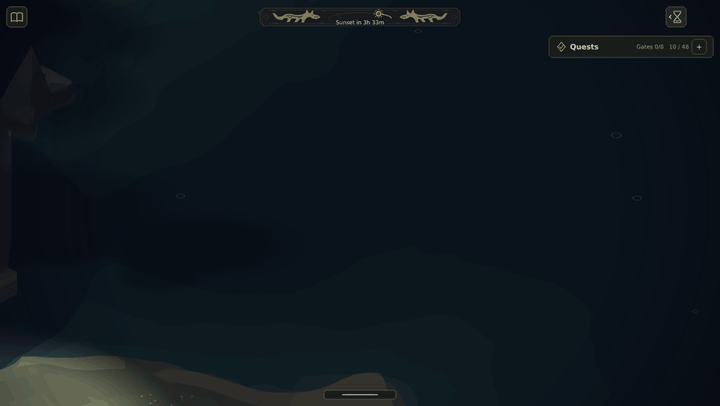

_Jormungandr's coils rise in a storm, at about three and a half times the pace of play._

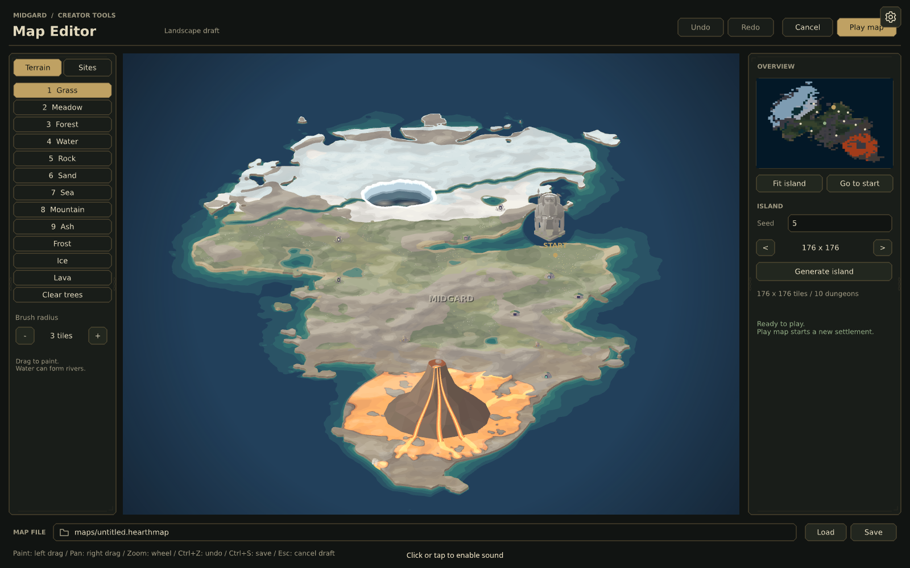

_The whole world, seen in the Map Editor without exploration fog. Normal play reveals it as residents explore._

## Draw your own world

Open **Map Editor** from the title screen and paint the landscape directly. Trace a river, grow a forest, and reshape the terrain as the map updates beneath your brush. Undo and redo strokes, then save the map or use **Play map** to start a settlement in it.

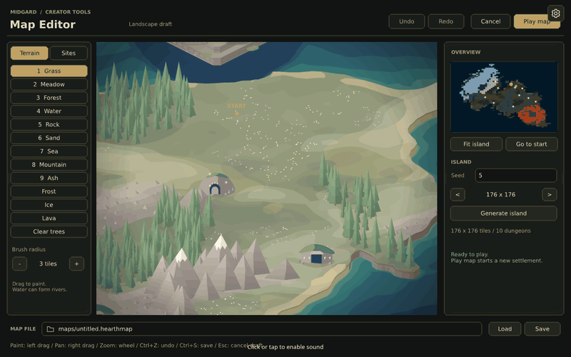

_Real brush strokes, undo and redo in the Map Editor._

## Buildings are small 3D models

A building is not a picture. It is a handful of blocks with walls, roofs, windows and doors, described as data, projected into flat vector shapes at any angle and drawn by ThorVG. That is how a building turns with its placement, rises block by block while it is built, and changes when a workshop is raised a level.

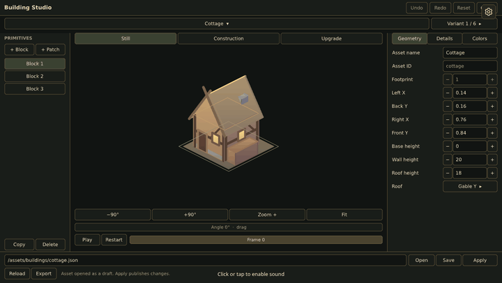

_The Building Studio editing the cottage: one block made taller, its roof changed and windows added._

## Make it your world

- **Character Studio** (`?character-studio`): give your settlers a face of their own, compare with the original, undo, and save a character preset.
- **Building Studio** (`F4` in a game): edit each building's blocks (their size, wall and roof heights, roof shape, windows, door, trim and colours) and variants, preview it still, rising or being upgraded at any angle, then apply it to the running game, save or export it.
- **Save and continue:** return to your settlement later. The title's autonomous village is a separate simulation and does not change your saved game.
- **Korean:** choose **KR** under **Settings → Language**, on the title screen or in a game.
- **Touch screens:** tap to select and give orders, drag to pan and pinch to zoom; buildings are placed with an on-screen reticle.

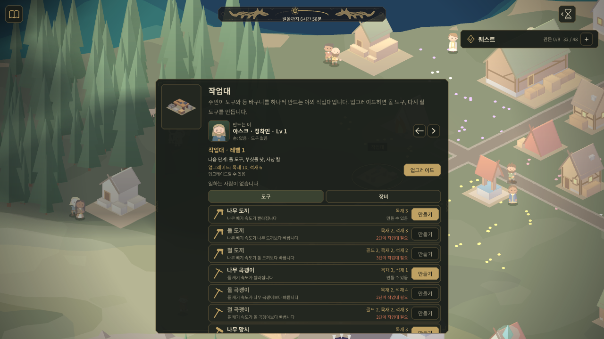

_The game in Korean._

## Drawn with ThorVG WebCanvas

Midgard is a playable showcase for **[ThorVG WebCanvas](https://github.com/thorvg/thorvg.web)**. Its vector artwork, animated buildings, characters, weather, combat effects and in-game canvas UI are rendered in the browser through WebCanvas.

The game logic is TypeScript. WebGL is the default renderer; WebGPU can also be selected. The world fills the browser window and follows window-size and display-scale changes.

Every picture above is captured from the actual renderer (see [Rebuilding the README media](#rebuilding-the-readme-media)). Captions say which scenes are prepared and which are sped up.

**[How it is made](https://thorvg-community-kr.github.io/Midgard/docs.html)** is a presentation page with sound: the opening, the game loop, how ThorVG is used (the paint tree, optimisation, the shared skeleton and clips, weather and combat effects), the placement and road algorithms, and how AI was used. Its source is [`public/docs.html`](public/docs.html), served at `docs.html` beside the game.

## Controls

| Action                         | Input                                                  |
| ------------------------------ | ------------------------------------------------------ |
| Select a unit or object        | Left click                                             |
| Select a group                 | Left-button drag                                       |
| Command selected units         | Right click a destination or target                    |
| Prepare Move / Attack / Work   | `M` / `A` / `E`, then choose a target                  |
| Hold position / Stop           | `H` / `S`                                              |
| Skills of the selection        | `Q` / `W` (ground skills: hold to aim, release to cast) |
| Next calling on the skill card | `Tab` while residents of several callings are selected |
| Control groups                 | `Ctrl+1-9` make, `Shift+1-9` add, `1-9` select, twice to look |
| Select the fighters            | `F2` or `` ` `` (beyond a gate, `` ` `` selects the party) |
| Recall the party beyond a gate | `R`                                                    |
| Build with the selection       | `B`                                                    |
| Pick a building to place       | Its letter key (any letter not on the command card); `R` rotates |
| Pan the camera                 | Arrow keys or right-button drag                        |
| Zoom                           | Mouse wheel                                            |
| Pause / change speed           | `Space` / `Tab`                                        |
| Cancel                         | `Esc`                                                  |
| Guide log                      | `F1`                                                   |
| Save                           | `Ctrl+S` or `Cmd+S`, or the settings menu              |
| Open Building Studio           | `F4`                                                   |

Continue, Start New Game, Load Game, Map Editor and Settings are on the title screen. Browser sound begins after an interaction.

The opening splash uses the supplied Powered by ThorVG animation while the world loads. Tap or click once to enable sound. Opening effects are loaded first; music and the voices in use take priority over the remaining audio downloads.

## Play locally

Use **Node.js 24** and npm, matching the CI environment.

```sh
npm ci
npm run dev
```

Open the address printed by Vite, normally **http://127.0.0.1:5173/**.

Saves, maps and custom assets are stored in IndexedDB and persist across reloads. Clearing site data removes them. Different browser profiles or site origins (protocol, host or port) use separate storage; paths on the same origin share it. Existing GoldFantasy saves remain compatible with Midgard.

## Production build

```sh
npm run build
npm run preview
```

The production site is written to `dist/`. It runs on static HTTP(S) hosting; no game server or account is required.

Optional launch parameters include `?seed=42`, `?renderer=wg`, `?character-studio` and `?map-editor`.

## GitHub Pages

The [Pages workflow](.github/workflows/pages.yml) builds and deploys `dist/` when changes reach `main`. It can also be started manually from the Actions tab.

1. In the repository, open **Settings → Pages → Build and deployment**.
2. Set **Source** to **GitHub Actions**.
3. Push the changes to `main`, or run the **Deploy Midgard to GitHub Pages** workflow.

For the current repository, the site address after a successful deployment is:

**https://thorvg-community-kr.github.io/Midgard/**

The repository was renamed from GoldFantasy to Midgard, so the Pages URL is now `/Midgard/`. Old `/GoldFantasy/` links no longer work. The workflow reads the base path from the Pages configuration so fonts, audio, the audio worklet and WebAssembly load correctly below `/Midgard/`.

For another static host, set the base path before building, for example:

```sh
VITE_BASE_PATH=/midgard/ npm run build
```

Serve `dist/` at that path with WebAssembly served as `application/wasm`.

## Regression checks

```sh
npm test
npx playwright install chromium
npm run test:roads
npm run test:loading
npm run test:audio
```

`npm test` runs the tracked suite in `tests/regression/`: rules of the simulation, combat, crafting, the guide, saves and the HUD. The browser checks drive the actual game UI headlessly with muted output, on their own temporary servers, and close their own resources: roads drawn in all four directions around a naturally built first camp, the supplied splash, early touch sound activation and playback before background audio finishes. More are listed in `package.json` (`test:realm`, `test:combat-loop`, `test:prayer`, `test:mobile` and others). The build workflows only install and build (`npm run build` typechecks first); run these checks locally before pushing.

Real WebAssembly ownership checks also repeat UI reordering, clipping, masking and animation moves 70,000 times. Asset preparation applies a checksum-verified reference ownership fix to the pinned WebCanvas 1.1.3 package; changing that dependency requires reviewing the compatibility patch.

## Rebuilding the README media

```sh
npx playwright install chromium
ORCA_BACKGROUND_LAUNCH=1 npm run media:readme
```

This rebuilds every image and GIF in `.github/media/` from the running game in a hidden, muted Chromium on the real GPU, on its own temporary server. It needs `ffmpeg` on the `PATH`. Name scenes to rebuild only some of them (`npm run media:readme -- army gods`); the scenes are the files in [`scripts/readme-media/`](scripts/readme-media/). Frames and four-frame contact sheets for checking each GIF are written to `artifacts/readme-media/`. The presentation page's videos are rebuilt the same way with `npm run media:docs` (scenes in [`scripts/docs-media/`](scripts/docs-media/); it reuses the README frames for its time-lapses, so run `media:readme` first).

## Technology and credits

| Technology / asset                                       | Used for                                                                  |
| -------------------------------------------------------- | ------------------------------------------------------------------------- |
| [ThorVG WebCanvas](https://github.com/thorvg/thorvg.web) | World rendering, vector characters and buildings, effects and canvas UI   |
| TypeScript                                               | Simulation, navigation, orders, economy, scenes, editors and audio mixing |
| Vite + npm workspaces                                    | Development, production builds and the TypeScript monorepo                |
| Web Audio + AudioWorklet                                 | Ambient sound, music, effects and voices                                  |
| IndexedDB                                                | Browser-local saves and creative documents                                |
| Lua 5.4.8 in WebAssembly                                 | Optional scripted HUD extensions                                          |
| DejaVu Sans / DejaVu Sans Bold                           | In-game text                                                              |
| Noto Sans KR                                             | Korean in-game text                                                       |
| Cinzel                                                   | Title lettering and combat numbers                                        |
| Loach-generated audio                                    | Procedural music, ambience, effects and generated voice banks             |

Midgard continues the GoldFantasy project and its original game artwork and rules.

## License

The project is distributed under **GNU GPL version 3**. See [LICENSE](LICENSE).

Third-party components keep their own licenses:

- **ThorVG WebCanvas:** [MIT license](public/licenses/ThorVG-WebCanvas-1.1.3.txt).
- **Lua 5.4.8:** [MIT license](public/licenses/Lua-5.4.8.txt).
- **DejaVu fonts:** [Bitstream Vera license and DejaVu public-domain changes](public/assets/native-fonts/DejaVuSans.LICENSE).
- **Noto Sans KR:** [SIL Open Font License 1.1](public/assets/native-fonts/NotoSansKR.LICENSE).
- **Cinzel:** [SIL Open Font License 1.1](public/licenses/Cinzel-OFL.txt).
- **Audio:** [asset-specific provenance and notices](public/assets/audio/NOTICE.md).
- **Powered by ThorVG splash:** [supplied animation source and provenance](public/assets/branding/NOTICE.md).

See [all third-party notices](public/THIRD_PARTY_NOTICES.md) for additional bundled material.
