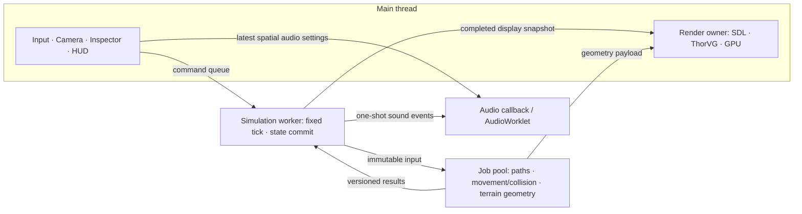

**Multithreading and ECS Architecture Review — 2026-11-07**

The recommendation is **keep render ownership → split out pure CPU work → set up a simulation snapshot boundary → convert the systems that need it to ECS**. Moving to multithreading is feasible. A full ECS replacement is not a prerequisite for it. The population cap in a normal game is currently 30 (`Town::maxPeople`), and the recent heavy loads were observed in map/terrain generation and in large numbers of path requests. Neither a speedup from adopting ECS itself nor a speedup proportional to the thread count has been measured yet.

This review was done by reading the source, the installed dependencies, the current HTTP responses and the official documentation. Because other work is changing the source, no additional game builds, runs or benchmarks were performed. Runtime code, assets and the current preview were not changed. The names and file layout below are proposals, not APIs that have been implemented yet.

**Current Execution Flow and Coupling**

`src/ui/host/host.cpp: Session::tick` runs SDL events → canvas sync → `Application::render` → GPU draw/present. Within `src/game/game_app.cpp: GameApp::render`, `Town::advance` → `Traffic::update` → `WorldRenderer::update` → HUD are processed. Game state updates are contained in a presentation function.

| Area | Current ownership / access | Problems when separating |
|---|---|---|
| Simulation | `Town` owns people, buildings, monsters, stock, the map, roads, WalkGrid and the RNG | The renderer and Inspector read internal vector references and element pointers directly. Even const references are not safe under concurrent writes. |
| Movement and collision | `town_people.cpp`, `town_monsters.cpp`, `walk_paths.cpp` | Path integration, doorways, road work and combat jointly modify position, activity, health and shared resources. There is no standalone physics engine. |
| Rendering | `WorldRenderer`, `ui::Context`, `ui::Renderer` | Creating and modifying retained paints, managing their reference counts, and GPU submission all assume the same owner. |
| Editor | `application.cpp: sceneProperty` | Copies the entire current object into a draft, then writes position, health and so on back all at once. Simply turning this into a queue could overwrite the current state with stale health and other values. |
| Assets | Mutable global Catalog in `building_models.cpp` | Not only rendering but also the new `Building::entrance/door` calculation reads assets. A boundary is also needed between hot reload and the simulation. |
| Play/Stop | `Application::command`, `retiredGames` | Play clones the GameApp and Stop restores the authored state. The release timing currently depends on the next frame's canvas sync. |
| Lua and text | The VM/Context in `Script::Impl`, `FontDatabase` | The VM, button callbacks and font registration are not structured to run together outside their owning thread. |
| Audio | `SoundBoard::render` | Native has an SDL callback path, but the actual SDL port in the browser uses a main-thread ScriptProcessorNode. |

`Town::advance` splits time into steps of at most 0.1 seconds, but the last dt varies with the input time. It is not a fixed-tick accumulator yet. The current order in `Town::tick` is also significant: grid update → guest spawning → monsters → people → removal. Parallelizing road workers, tree claiming, combat and RNG calls all at once can produce different results even from the same initial state.

**Recommended Execution Architecture**



Rendering should run on a different thread from the simulation, but on the current host the preferred configuration is one where **the main thread is the render thread**. The official SDL3 contract requires `SDL_PollEvent`, `SDL_GL_MakeCurrent`, `SDL_GL_SwapWindow` and similar functions to be used on the main thread. The approach of moving the current GL calls onto a generic worker is not adopted. [SDL event contract](https://wiki.libsdl.org/SDL3/SDL_PollEvent), [GL context contract](https://wiki.libsdl.org/SDL3/SDL_GL_MakeCurrent), [screen output contract](https://wiki.libsdl.org/SDL3/SDL_GL_SwapWindow).

Even when physics and game logic run on separate executors, they must not write the same Transform concurrently. The simulation owner decides commands and game rules, and physics jobs compute movement and collision results from immutable input. The owner applies those results at a defined stage of the tick. While workers compute, the main thread keeps rendering from the last completed snapshot. Avoid designs that let physics and logic advance without bound on separate clocks.

When introducing a fixed tick, decide the tick interval, speed multiplier, pause, single-step and catch-up limit together. Preserve the existing AI/economy results first, then verify intentional rule changes separately. For now, the shared RNG keeps its ordering in the owner. Moving to per-system or per-entity RNGs also affects reproducibility, so it is a separate step.

**State and Message Contracts**

- Simulation state has a single owner as its writer. Do not pass `Town&`, `Person*` or references to asset elements to workers. When introducing parallel ECS systems, specify their disjoint component sets and read/write dependencies explicitly.
- Input is delivered in the form `worldEpoch + commandSequence + entityId/generation + changed fields`. An Inspector position change must not also overwrite health or progress. The owner validates it against the current state and publishes `inputAck`.
- `RenderSnapshot` holds `worldEpoch`, `simTick`, `inputAck`, the map/road/asset revisions, and display arrays of people, buildings, monsters and traffic. It includes position, direction, animation, doorway state and appearance handles, and excludes pointers to internal state.
- The 7 float layers of the largest map alone are `513×513×7×4 = 7,368,732 bytes`. Do not copy the entire Town/map every tick. Keep the static map, navigation and assets as immutable versions/chunks, and publish only the dynamic display data.
- Apply double/triple buffering to value data. Lease/completion acknowledgement and acquire/release publication rules are needed so that the producer cannot overwrite a slot the consumer is reading. The main thread does not block waiting for a new snapshot.
- Stale render snapshots may be skipped. Construction/commands/Stop and one-shot sound events must not be dropped the same way. Queues specify their capacity and saturation policy, and stale jobs are discarded by revision.
- Camera and mouse feedback are handled immediately on the main thread. Picking is based on the snapshot, camera and viewport actually displayed, and entity validity is rechecked at command commit.
- On-screen unit positions and the fog use the same snapshot or a consistent interpolation basis. If visibility jobs fall behind and old masks are shown one after another, the earlier lagging-visibility problem returns. Visibility work must also display only the latest revision.

Play/Stop, map replacement, Undo and asset reload need session boundaries. Discard results whose epoch has changed, and release the old world/scene/script only after the previous simulation jobs and render references have finished. The same integer ID can exist on both the authored and runtime sides, so validating by entity ID alone is not enough. Synchronously waiting for `join` or job completion on the browser main thread can deadlock with proxied calls. [Emscripten main-thread blocking constraints](https://emscripten.org/docs/porting/pthreads.html#blocking-on-the-main-browser-thread).

Currently `visibilityPicture` borrows the CPU pixels with `copy=false`. A worker must not reallocate that vector or return it to a pool. The buffer must be held until that picture is no longer in use. Also, given ThorVG Paint's current non-atomic reference count and the Context's ref/unref flow, keep the creation, use and release of every paint/scene/animation/picture with the render owner. Holding a global scene mutex across all of draw/sync would recreate input waits and serialization.

The host currently uses `tvg::Initializer::init(0)`. In the Web SDK we checked, ThorVG's GL path calls geometry preparation and tessellation directly, while the Lottie/SVG loaders have a separate TaskScheduler submission path. Raising the thread count at initialization does not by itself separate the game, physics and render systems. Loader-internal parallelism and the application job pool must be verified separately.

**Work to Parallelize First**

| Target | Separation boundary | Recommendation |
|---|---|---|
| Terrain | Contour, cliff and ribbon computation in `terrain_painter.cpp` → path commands/vertices/style IDs → ThorVG creation on the main thread | High priority, since it is directly tied to the CPU load of large editor brushes. Do not pass `Tinted::Shape*`. |
| A* paths | Immutable NavigationSnapshot → `WalkGrid::path` → versioned path | Start by batching group-movement and road-work requests, and preserve the existing order of application. |
| Building appearance | Fixed asset revision → model/JSON generation → `Picture/Animation::load` on the main thread | Do not read and write the Catalog concurrently with the asset editor. |
| Visibility | source array → coverage/RGBA → upload on the main thread | In ordinary scenes where the computation is already small, the dispatch cost may be larger. Do not split it unconditionally. Overlapping sources write the same pixels, so a simple per-source parallel for is not safe either. |
| Movement and collision | movement intent + previous Transform + navigation → MoveResult | Apply after separating doorway/arrival events, combat and road work-front updates out into the owner commit stage. |
| Traffic | Snapshot of the Town's roads/buildings/population → its own agents snapshot | Can be separated after lifetime boundaries are established for Town reads and renderer reads. |

`WalkGrid::path` creates its temporary search data per call and only reads the grid. However, `rebuild` overwrites the same costs/obstacles, so an immutable navigation version must come first. Requests carry `{worldEpoch, navVersion, entityId, requestId, from, to}`, and results are not applied after a move, removal or goal change. Do not make the AI that currently relies on `walkTo`'s immediate success/failure fully asynchronous from the outset. When going asynchronous, also distinguish `pending` from `no_path`.

A*'s score/parent arrays take about 0.5MiB per request on the largest map. Use a bounded pool with per-worker scratch instead of unlimited workers. Batch short jobs and allow small requests to be processed serially. Give path/physics work and terrain work distinct priorities so that a large terrain job does not hold up command processing for long.

**ECS Adoption Assessment**

| Option | Assessment for this project |
|---|---|
| Replace all of Town with ECS immediately | Not recommended. The scope of the concurrency work and of the semantic changes to the economy, AI, editor and Play/Stop is large. |
| Separate only state ownership and job queues first | Recommended as the first step. Render/simulation parallelization and ECS can be verified independently. |
| Convert movement, visibility and combat to components/systems first | Medium-term recommendation. Move the Town rules over gradually while building the common engine's entity/runtime structure. |

The minimal component candidates are `Transform`, `MotionPath`, `DoorwayMotion`, `Order/Activity`, `Needs/Vitals`, `Combat`, `Residence/Employment`, `Appearance` and `VisibilitySource`. Time, climate, stock, the map, navigation and the asset catalog remain world resources. There is no need to make every tile, fog pixel and individual tree an ECS entity. Also avoid dual state in which the same position is updated in both Person and the ECS.

EnTT is the candidate for incrementally adding a registry to the current C++ structure. However, the registry as a whole does not automatically become thread-safe, and the organizer only provides an execution graph, not an executor. [EnTT official ECS documentation](https://github.com/skypjack/entt/wiki/Entity-Component-System#multithreading), [organizer contract](https://github.com/skypjack/entt/wiki/Entity-Component-System#organizer).

If the library should also take over the system pipeline, worker distribution and staging, Flecs is worth comparing. It can configure parallel systems and the worker count, but it does not resolve the lifetimes of, or conflicts with, external SDL/ThorVG/Lua objects. The semantic effect of staging, which changes when structural changes take effect, must also be verified. [Flecs official threading/staging documentation](https://www.flecs.dev/flecs/Systems.html#threading). Before settling on a library, it is better to validate with a single movement/navigation system.

**Conditions to Resolve First in the Browser**

Currently `tools/web_build.py` does not add `-pthread` to the app's compile/link, and it also configures ThorVG with `threads=false`. The app's use of pthreads and ThorVG's internal use of workers are separate matters. When introducing a shared-memory build, the app and its dependencies must use a matching thread ABI and a separate cache/install path.

Emscripten's pthread mode requires `-pthread` at both compile and link time. The worker pool can be prepared in advance, and since a single binary does not handle both pthread-capable and pthread-incapable environments, a loader that chooses between separate threaded/single builds is needed. [Emscripten official pthread documentation](https://emscripten.org/docs/porting/pthreads.html#compiling-with-pthreads-enabled).

The runtime environment requires cross-origin isolation. The current server on port 8080 responded as `SimpleHTTP/0.6` and sent no COOP/COEP headers. The current ordinary serving setup therefore does not meet the conditions for running shared-memory pthreads. HTTPS or a trustworthy localhost environment, COOP/COEP, and the loading policy of every subresource must all be checked together. [MDN crossOriginIsolated](https://developer.mozilla.org/en-US/docs/Web/API/Window/crossOriginIsolated).

```http
Cross-Origin-Opener-Policy: same-origin
Cross-Origin-Embedder-Policy: require-corp
```

If the server policy cannot be changed right away, an alternative is to split terrain work off with an independent Web Worker + a separate Wasm instance + transferable ArrayBuffers. This is different from Emscripten's shared-memory Wasm Workers API. The cost of transferring the map input and of the separate heap must be measured. [MDN Web Workers](https://developer.mozilla.org/en-US/docs/Web/API/Web_Workers_API/Using_web_workers).

A dedicated render worker using OffscreenCanvas is a target for a later host redesign. Currently `syncBrowserViewport` accesses the DOM/window, and Session already creates the canvas's GL context. Canvas ownership must be chosen before startup, and resize, input, DOM and exported host commands must be split into messages. Merely adding `PROXY_TO_PTHREAD` to the current code will not get this done. [MDN OffscreenCanvas](https://developer.mozilla.org/en-US/docs/Web/API/OffscreenCanvas).

For browser audio, the current SDL 3.4.2 source creates the ScriptProcessorNode in `MAIN_THREAD_EM_ASM`. Adding only a simulation worker does not turn this audio path into an independent real-time thread. AudioWorklet must be evaluated as a separate backend, and the mixer's blocking mutex and dynamic allocations must be removed. A Wasm AudioWorklet's dedicated audio callback is a different path from ordinary pthreads. [Emscripten Wasm AudioWorklets](https://emscripten.org/docs/api_reference/wasm_audio_worklets.html).

**Implementation Order and Verification Criteria**

1. On the same thread, separate `GameApp`'s simulation/presentation responsibilities and create the Command/RenderSnapshot contract. Have authored/runtime and the Inspector API use this contract as well. This step does not change execution order or behavior.
2. Introduce a common executor with immutable inputs and revisioned results. Apply it first to terrain geometry and group path requests, and manipulate render objects only on the main thread. Choose a bounded worker pool for native and a separate platform-appropriate implementation for the web.
3. Move Town/Traffic and the fixed tick onto the simulation worker. The main thread renders from completed snapshots and does not block waiting on commands. Complete cancellation and release acknowledgement for Play/Stop, map replacement and asset reload.
4. Split movement and collision into a read-input stage and a result-commit stage, and convert to ECS starting with the data that needs it. Declare read/write resources for each system to be parallelized. Keep the application order of the road work front, stock, combat and the RNG explicit.
5. Pursue the browser AudioWorklet and, if needed, a separate render-worker host as independent tasks.

A natural layout puts the common primitives, a bounded queue/executor, in `core`, the lifecycle, tick and entity contracts in `GameEngine/runtime`, and the game rules in `game`. SDL/ThorVG/Lua objects are not included in executor job data. The first change does not move the GameFramework asset code and physics/AI all at once.

Verify against the same pinned source with O3 settings. Do not use a workspace that is still being worked on as the before/after baseline. First stabilize the existing functional tests, then feed the same command trace to serial and threaded runs and compare whether per-tick positions, stock, road progress and combat results match. Even a mere change in component iteration order can break the baseline.

The required loads are a large brush on the largest map, many path requests combined with branching-road construction, adding/removing obstacles while units are moving, late path results, repeated Play/Stop and reload, damage taken during Inspector edits, and worker queue saturation. Record GPU sync and GPU execution time, job queue latency, input→screen latency, snapshot age, peak memory and audio underruns together. Do not judge success by callback FPS alone. On native, apply non-render concurrency checks and ThreadSanitizer first; on the web, verify threaded/fallback, COOP/COEP and context loss separately.

This conclusion is a review of **performance-improvement potential and safe change boundaries**. It is not yet the result of implementing a multithreaded runtime or measuring its speedup.
